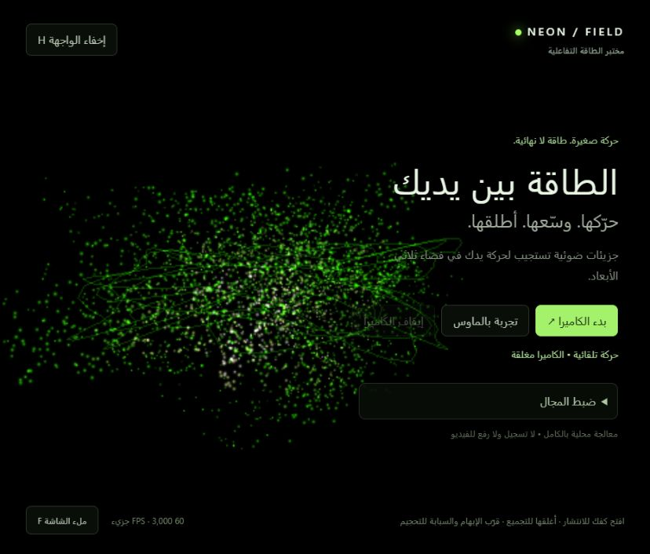

# NEON FIELD

**Energy at your fingertips.** An interactive 3D neon particle field controlled by hand tracking or a mouse, with an Arabic interface.

[](https://github.com/moamendahshann/neon-hand/actions/workflows/ci.yml)

**[Launch the live demo](https://neon-hand-moamen.daringtide16.chatgpt.site)** · [العربية](README.ar.md) · [Contributing](CONTRIBUTING.md)



## Try it

Open the demo and choose **تجربة بالماوس** (mouse demo), or **بدء الكاميرا** (start camera) and grant camera access. A camera is optional. The first camera session downloads the model and WASM assets.

| Control | Result |
| --- | --- |
| Move one hand | Move the field in a mirrored direction |
| Open palm / close fist | Spread particles / gather the energy |
| Thumb–index distance | Change the field's size relative to palm scale |
| No visible hand | Ease into automatic motion |
| Mouse move / press / release | Move / gather / spread |
| Mouse wheel | Resize |
| H / F | Hide the interface / toggle fullscreen |

The camera preview is hidden by default and can be enabled in settings. Stop camera closes its media tracks. There is no separate dot trail behind movement.

## Run locally

Use Node.js 24. On Windows, double-click **START.bat** after downloading the source. Or run:

```bash
npm ci
npm run dev
```

Open http://localhost:5173. Asset preparation runs automatically before development and production builds. The first setup needs internet; subsequent local runs use the downloaded assets. Do not open index.html directly.

## How it works

- **Three.js / WebGL2:** GPU particle motion and animated filaments, with a fast direct-render mode and optional cinematic bloom.
- **MediaPipe Hand Landmarker:** inference in a dedicated classic Web Worker; GPU acceleration with CPU fallback and model warm-up before readiness.
- **Gesture processing:** hand-relative ratios, a dwell threshold for open/closed gestures and separate position smoothing.
- **Performance:** one inference request in flight, no frame queue, adaptive render resolution and a target rendering ceiling around 60 FPS. Defaults favour responsiveness over density.

Settings control colour, glow, particle count and motion sensitivity. Rendering FPS and inference duration are different measurements; both are useful when diagnosing delays.

## Camera privacy

Video processing happens on the visitor's device. The application does not record or upload camera frames and includes no analytics. Hosting serves application files and model assets. Camera access needs HTTPS or localhost and permission from the visitor.

## Validation and limits

```bash
npm test
npm run build
```

The CI workflow checks unit tests and the production build. For model initialisation and synthetic-frame inference, open /model-check.html while the application is served. This does not test real-hand tracking quality.

The application and local model inference were inspected in a browser, including on the published site. A live hand and camera were not verified by the implementation agent. Lighting, occlusion, browser support and device performance affect results; no specific FPS or absence of stutter is guaranteed. The originally described reference video was not available for visual comparison.

See [the detailed validation record](VALIDATION.md). The optional scripts/browser-test.mjs suite requires a Playwright Chromium installation and is not reported as passed in that record.

## References

[Three.js](https://threejs.org/manual/pages/installation.html) · [MediaPipe web guide](https://developers.google.com/edge/mediapipe/solutions/vision/hand_landmarker/web_js) · [Vite](https://vite.dev/guide/)

Student portfolio project developed with AI assistance. Third-party libraries and model assets retain their own licenses. No open-source license has been selected for this repository; public visibility alone does not grant broad reuse rights.
